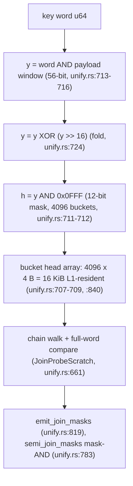

# 17-c4-architecture

C4 architecture model for the cgap v26.11.2 starDF substrate. Canonical
home is now `docs/jira/v26.11.2/dflss/17-c4-architecture.md`; the former
orphan `docs/jira/v26.11.2/17-c4-architecture.md` redirects here
(lane DF-2). Migrated from the orphaned file with grounding corrections
intact; standing vocabulary per `11-measured-claims.md`. The container
view is the actual crate graph per `boundary_gate.py --deps` (run fresh
this session: E=0 runtime externals across 15 covered crates, exit 0).

## Fresh boundary-gate table (run 2026-11-02, exit 0)

| Crate | E | runtime_deps |
|---|---|---|
| cgap-core | 0 | 0 |
| cgap-storage | 0 | 1 |
| cgap-bont | 0 | 1 |
| cgap-bosym | 0 | 0 |
| cgap-bn3 | 0 | 1 |
| cgap-gate | 0 | 1 |
| cgap-crypto | 0 | 1 |
| cgap-p28 | 0 | 2 |
| cgap-court | 0 | 0 |
| audit | 0 | 2 |
| cgap-arrow | 0 | 0 |
| cgap-blake3 | 0 | 0 |
| cgap-git | 0 | 0 |
| cgap-parquet | 0 | 0 |
| ontologies/fibo | 0 | 1 |

## Level 1 - System Context

External actors: ledger consumers (columnar analytical workloads), P28
license compliance regime (attestation + spoliation audit), FFI
consumers (sovereign entrypoints via cdylib), court/gate infrastructure
(boundary gate, zero-string gate, court_verdict), plus the DMEDI-era
suppliers from `16-sipoc.md` Section 1: DMA ring producers, git pack
streams, A2A agents.

```mermaid
C4Context
  title cgap v26.11.2 starDF - System Context
  Person(ledger_consumer, "Ledger consumer",
    "columnar/deductive analytics over WAL-backed frames")
  System(cgap, "cgap",
    "sovereign columnar/deductive substrate",
    "A04 CgapFrameHeader (128 B), A17 P28LicenseAttestation (80 B)")
  System_Ext(regime, "P28 regime",
    "license attestation + spoliation audit (A17)")
  System_Ext(court, "Court harness",
    "cgap-court + boundary/zero-string gates (fail-closed)")
  Rel(ledger_consumer, cgap, "FFI sovereign entrypoints (A19)")
  Rel(regime, cgap, "attestation validation, spoliation register reads")
  Rel(cgap, court, "court runs, mutation flips, receipts")
```

## Level 2 - Container diagram (ASCII, actual crate graph)

```text
                    (standalone crates, not workspace members)
    +----------------------------------------------------------+
    | csct (standalone)            cli (standalone, ggen)      |
    | receipt.rs -> cgap-blake3    generated command surface   |
    | csct_pipeline_court.rs       make gate0 byte-replay      |
    +------------------------+---------------------------------+
                             | dep
                             v
 DMA ring producers ---> cgap-core (Tier 0, A04 frame.rs:178)
 pack streams, A2A agents ---> cgap-git (zero-dep kernel)
     |
     |  cgap-git internals:
     |    ref_store.rs:32 SEAL_REGISTER_ADDR 0x0001_FF80
     |      (ABSTRACT 128-B slot, provenance ref_store.rs:1-13, GIT-13)
     |    a2a_swarm.rs:1-13 swarm leases, NO SMP claim
     |    mcp_driver.rs:1-14 fixed-schema TEXT, NOT JSON-RPC
     v
 cgap-gate penstock.rs:317-319 (0x5032_38FF register)
     |
     v
 cgap-bn3 unify.rs:840 RADIX_BUCKETS=4096
     |   unify.rs:661 JoinProbeScratch, :819 emit_join_masks
     v
 cgap-storage dred.rs (DRed retract fixpoint; dred_cascade.rs)
     |
     v
 cgap-parquet mmap_writer.rs:721 RingSink (Tier 2/3 commit surface)
     ^
 cgap-ffi sovereign.rs:83 CgapStatus register; :729-794 commit lease (A19)
```

## Level 3 - Component (Tier 0 + Tier 1)

Tier 0 is the A04 transport kernel; Tier 1 moonshot lanes sit on top.
Several crates are `#![no_std]` today (divergence D2); the std-strip
for the rest is [TARGET] until it lands.

```mermaid
C4Component
  title Tier 0 + Tier 1 - Components
  Container_Boundary(core, "cgap-core (Tier 0)") {
    Component(frame_hdr, "CgapFrameHeader", "Rust struct",
      "128 B A04 header (frame.rs:178)")
    Component(dma, "dma_ring", "Rust module",
      "DMA ring transport (dma_ring.rs)")
  }
  Container_Boundary(t1, "Tier 1 - moonshot lanes") {
    Component(penstock, "Penstock", "Rust",
      "admission taxonomy; spoliation register 0x5032_38FF",
      "(penstock.rs:317-319)")
    Component(unify, "Unifier", "Rust",
      "RuleCompiler (unify.rs:474), RegisterFile (unify.rs:412)")
    Component(probe, "Semi-join probe", "Rust",
      "JoinProbeScratch (unify.rs:661), radix_bucket (unify.rs:715-724)")
    Component(shacl, "SHACL mask compiler", "Rust",
      "CorpusRng (shacl_mask.rs:30)")
    Component(seen, "Bitplane seen-set", "Rust",
      "BitPlaneSeenSet (bitplane_seen.rs:36)")
  }
  Rel(frame_hdr, penstock, "128 B frames into admission")
  Rel(penstock, probe, "admitted words into bucket probe")
  Rel(probe, shacl, "masks into SHACL mask evaluation")
  Rel(probe, seen, "dedup via bitplane seen-set")
```

## Level 4 - Radix semi-join flowchart

The L4 flow: 56-bit payload window FIRST, then fold, then 12-bit mask
(verified `unify.rs:713-724`; `RADIX_BUCKETS=4096` at `unify.rs:840`).



Caption: the O(N+M) claim covers the bucket-scan prefilter only —
radix bucketing plus chain walk over `JoinProbeScratch` (`unify.rs:661`);
the inner full-word comparison retains its own cost; `semi_join_masks`
(`unify.rs:783`) is O(mask words). No whole-pipeline linearity claimed.

## Ingress performance claim (migrated, correction 3)

The full L1 chain is **[MEASURED] 10.20 ns/frame fastest (10.30
median)** at 1,048,576 frames, divan, quiet host, receipt
`waves/w3-l1-ingress.md:63,69-70`, registered in
`11-measured-claims.md:29` (row 5). The <15 ns/frame target is MET by
that number on the quiet host only; contended divergence registered as
row 28 of `11-measured-claims.md:52` (124.06 ns/frame slowest under
combined bw+cpu load). Any sub-10 ns claim is [TARGET] until measured
under `06-bench-protocol.md`.

## Honest-notes register (mandatory)

1. Seal register `0x0001_FF80` is an ABSTRACT 128-B slot, not a
   hardware map — provenance `crates/cgap-git/src/ref_store.rs:1-13`
   (GIT-13), constant `ref_store.rs:32`; binds to no in-tree hardware.
2. Swarm leases carry NO SMP claim — single-threaded court,
   single-writer-per-agent; `core::sync::atomic` deliberately NOT used
   (`crates/cgap-git/src/a2a_swarm.rs:1-13`).
3. `mcp_driver.rs` is a fixed-schema TEXT envelope that is MCP-shaped,
   NOT JSON-RPC 2.0 (`crates/cgap-git/src/mcp_driver.rs:1-14`).
4. No hardware lore anywhere: register-style constants trace to named
   in-tree referents or are marked abstract.

## Receipt tail (commands run this session, exit 0 each)

- `python3 scripts/boundary_gate.py --deps` -> E=0 across 15 covered
  crates (exit 0) — table source above.
- `grep -n RADIX_BUCKETS crates/cgap-bn3/src/unify.rs` -> 840 (exit 0).
- `ls crates/cgap-git/tests/` -> `a2a_swarm_court.rs`,
  `ref_store_court.rs`, `mcp_driver_court.rs` present (exit 0).
- `sed -n '1,15p' crates/cgap-git/src/a2a_swarm.rs` -> SMP honesty
  note (exit 0).
- `sed -n '1,20p' crates/cgap-git/src/ref_store.rs` -> abstract-slot
  provenance (exit 0).
- `sed -n '1,14p' crates/cgap-git/src/mcp_driver.rs` -> NOT JSON-RPC
  note (exit 0).

## Divergences

- **D2**: an earlier dispatch said "only cgap-gate is no_std today";
  the tree verified wider (cgap-blake3, cgap-p28, cgap-parquet,
  cgap-crypto, cgap-arrow, cgap-git also `#![no_std]`). Doc yields to
  the tree.
- **D3**: 0x5032_38FF real homes: `penstock.rs:317-319` (register
  constant), `sovereign.rs:83` (CgapStatus export); cgap-p28 owns the
  `Spoliation` error type and ASC450 lease meter (`asc450.rs:622`),
  not the register constant.
